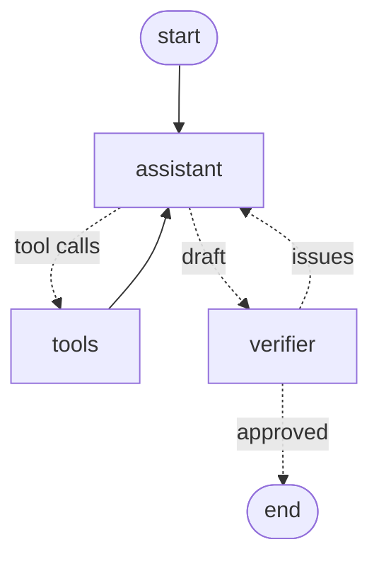

# jubilant-tribble
AI multi agent ChatBot.

# Mushroom foraging assistant

This is a multi-agent chat assistant for mushroom foraging in Sweden. It answers questions about species, lookalikes, recent sightings and recent weather. A separate reviewer agent checks every answer for safety before it reaches the user.

## Requirements
- [uv](https://docs.astral.sh/uv/) (installs the right Python version for you)
- [Node.js](https://nodejs.org/) 20.19+ or 22.12+
- A Gemini API key from [Google AI Studio](https://aistudio.google.com/apikey)

## Getting started

Install Python and the backend dependencies:
```sh
cd backend
uv sync
```

Create a `.env` file in the repo root:

```
GEMINI_API_KEY=your-key
MODEL_NAME=gemini-3.1-flash-lite
VERIFIER_MODEL_NAME=gemini-3.5-flash-lite
```

`MODEL_NAME` is the model the assistant uses and `VERIFIER_MODEL_NAME` the one the verifier uses. The embedding model is set in `backend/app/constants.py`.

The knowledge base articles are included in `backend/data/knowledge/`. The vector store is built from them automatically the first time the backend starts. To re-fetch the articles from Wikipedia (optional), run the command below and delete `backend/data/vector_store.json` so it is rebuilt:

```sh
cd backend
uv run python -m app.build_species_information
```


Start the backend:

```sh
cd backend
uv run fastapi dev app/main.py
```

Start the frontend:

```sh
cd frontend
npm install
npm run dev
```

## Technologies used:

-  **Backend:** Python, FastAPI, LangGraph and LangChain, uv
- **Frontend:** React, TypeScript, Vite
- **LLM:** Google Gemini
- **Data:** SMHI open data (weather), Open-meteo (geocoding), Wikipedia (species information), GBIF (sightings)


## Architecture

```
React chat UI -> FastAPI /api/chat -> LangGraph graph
```


In the graph, solid arrows always happen, dotted arrows are decisions made at runtime by the agents. The verifier decides whether the draft is approved or sent back. 

## Agents

**Assistant (research).** Drafts an answer for the user's question and decides which tools are to be used, if any. Tool use is also capped (`MAX_TOOL_ROUNDS`) to avoid the model rerunning a lookup for a topic that does not exist in the knowledge base; once the cap is hit, tools are disabled and it has to answer.

**Verifier (safety review).** Reviews the draft sent by the assistant before it reaches the user, focusing on correcting the draft on points related to safety and sourcing. It does not itself have access to any tools, but can read the tool calls the assistant made and their results. It responds with a structured output, `Verdict(approved: bool, issues: list[str])`.

## How the agents coordinate

The agents share one graph state, with the assistant model passing the draft to the verifier model and the verifier either rejecting or approving the draft. A rejected draft is removed from the history and its issues are passed back to the assistant through the state. The assistant gets at most 2 revisions (`MAX_REVISIONS`), so the agents can't loop forever. If the last revision is still rejected, or the verifier fails, the draft is sent with a warning to confirm with an expert. The agents' responsibilities are deliberately split into research and text generation for the assistant, and safety and fact verification for the verifier.

## Tools and RAG:
Three different tools have been implemented in this project.

Recent sightings: searches an area around a given location for sightings of a given mushroom. Helps the user know if others have seen the mushroom recently in their area and what's in season.

Get Weather data: provides information from SMHI about recent rain data for a given location. As rain is often a prerequisite for mushrooms growing this helps the assistant provide accurate current information about what is or is not growing.

Knowledge base search: A selection of articles from Wikipedia containing information relevant to mushroom foraging about a set of mushrooms both sought after edible ones and poisonous ones.

RAG is implemented to store the articles used in the knowledge base search. A set of articles is fetched from Wikipedia and trimmed to remove information unnecessary for foraging, then saved as markdown files. These are loaded, split by section (each chunk records its species and section, e.g. "Description > Similar species"), embedded and stored locally as a json file. Queries in the knowledge base search are compared to the embeddings.

## Example questions

Run the backend and watch its logs while asking these to see the tool calls, drafts and verdicts

> im looking to pick mushrooms this upcoming friday in the stockholm Area specifically im looking for porcini and winter chantarelle think ill have any luck?

> im thinking of picking some fly agaric mushrooms have the weather around köping been good for that recently?

> Are chanterelles good to eat?

> How can I tell a porcini apart from a bitter bolete?

> How much has it rained in Göteborg the last two weeks?

## What I would do with more time:

- Stream progress to the UI (tool calls, verifier review), since a rejected draft roughly doubles response time
- Persist chat history and the vector store (e.g. a database-backed checkpointer and vector DB) instead of keeping them in memory and a JSON file
- Add a forecasting tool, so the assistant can use upcoming weather, not just recent rain
- Add a Docker setup so the whole app runs with one command
